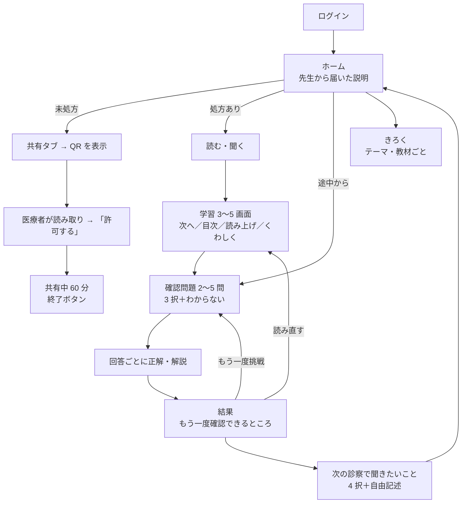
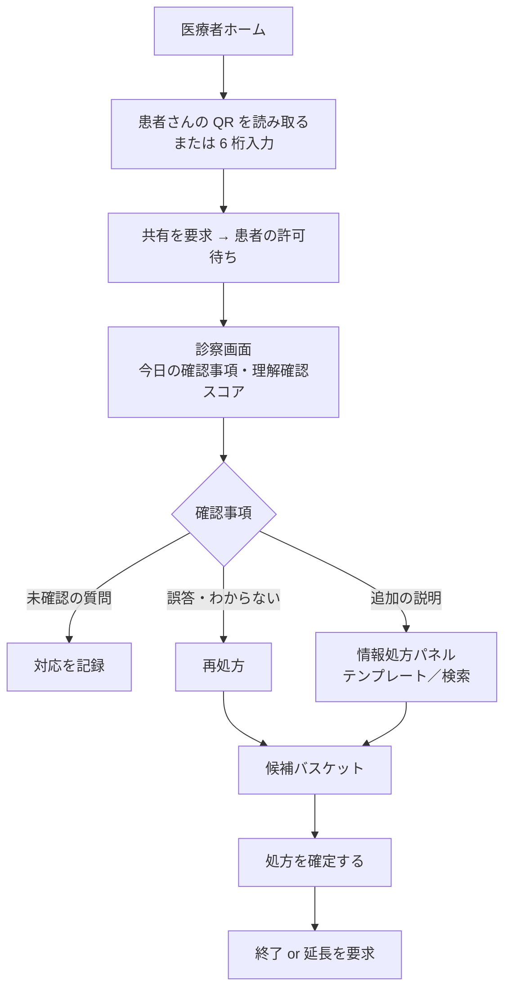
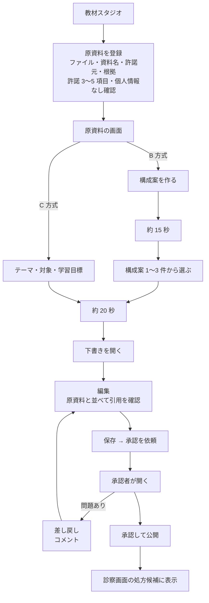

# ユーザーフロー（2026-11-03 時点の実装）

操作数は E2E（`tests/e2e/flow.spec.ts`・`studio.spec.ts`・`real_generation.spec.ts`）の実操作から数えた。

## 患者

| 場面 | タップ数（入力除く） | 所見 |
|---|---|---|
| 診察で共有する | 2（共有 → QR 表示）＋ 許可 1 | 良好。未処方ホームからの直接ボタンがあれば 1 減 |
| 届いた教材を読み終える | 1 ＋ 画面数（4〜5） | 良好 |
| 確認問題を終える | 問題数 × 2（回答・次へ） | 良好。回答直後の反応が遅れて見える（UX-08） |
| 質問を送る | 2（選択・送る）＋自由記述 | 良好。結果画面が長い（UX-18） |

## 医療者（診察）

| 場面 | タップ数 | 所見 |
|---|---|---|
| 共有開始 | 2 ＋ 6 桁入力（QR なら 1） | 良好 |
| 初回にテンプレートで処方 | 3（開く → まとめて追加 → 確定） | 外来で十分速い |
| 次回診察で誤答から再処方 | 2（再処方 → 確定） | 良好 |
| 質問への対応記録 | 2（対応を記録 → 記録する） | 良好 |

## 医療者（教材スタジオ：作成・承認）

| 場面 | 操作数 | 所見 |
|---|---|---|
| 原資料の登録 | 入力 4 ＋ チェック 4〜6 ＋ 登録 1 ＋ 遷移 1 | 許諾の記録として妥当。ファイル選択と小さいチェックボックスが課題（UX-14） |
| B 方式で下書きまで | 3 タップ ＋ 待ち 2 回（実 API で 15 秒＋22 秒） | 構成案が下部に出て見落としやすい（UX-03） |
| 承認まで | 編集者 2（保存・依頼）＋ 承認者 1 | 承認前に患者画面プレビューへのリンクなし（UX-04）、点検の要約なし（UX-07） |
